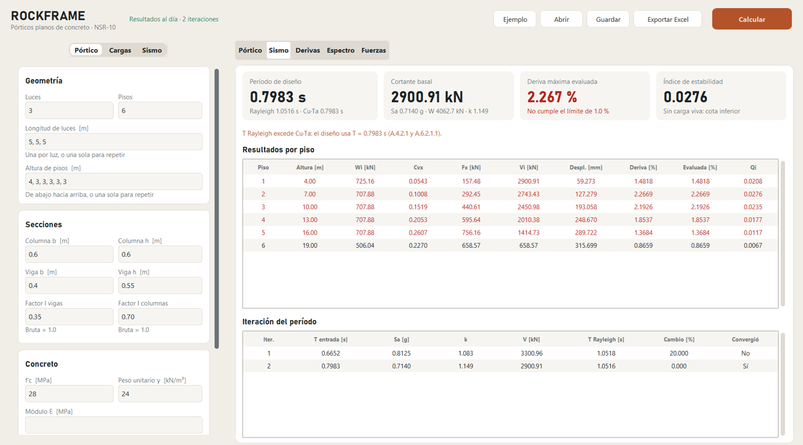

# ROCKFRAME

[English](README.md)

ROCKFRAME es un programa gratuito en Python para analizar pórticos planos de concreto reforzado, con análisis sísmico según la NSR-10.



## Instalación

1. Instala [Python 3.10 o superior](https://www.python.org/downloads/). En Windows, marca **Add python.exe to PATH**.
2. Instala [Git](https://git-scm.com/downloads).
3. Abre una terminal y ejecuta:

```bash
pip install git+https://github.com/Juankamiloh/RockFrame.git
```

## Cómo abrirlo

```bash
rockframe
```

Si el comando no aparece, usa `python -m rockframe`. Pulsa **Ejemplo** y luego **Calcular** para correr un pórtico de 3 luces y 6 pisos.

## Qué hace

- **Análisis del pórtico:** método matricial de rigidez con deformación axial, inercia bruta o fisurada, apoyos empotrados, articulados o personalizados, cargas distribuidas, peso propio y cargas en nudos.
- **Análisis sísmico NSR-10:** espectro de diseño, período de Rayleigh con el límite Cu·Ta, fuerzas horizontales equivalentes, derivas de piso e índice de estabilidad.
- **Resultados:** tablas por piso, fuerzas por elemento, reacciones, gráficas y reporte en Excel.

## Validación

| Comprobación | Casos | Diferencia máxima |
|---|---|---|
| ETABS 22.6: desplazamientos, giros, N, V, M | 12 comparaciones en 3 pórticos, inercia bruta y fisurada | 4×10⁻¹¹ % |
| OpenSees 3.8: mismas magnitudes, fuerzas con signo | 40 corridas en 4 pórticos | menos de 10⁻⁵ % |
| PyNite: mismas magnitudes, fuerzas en valor absoluto | 40 corridas en 4 pórticos | menos de 10⁻⁵ % |
| Período de Rayleigh contra primer modo | OpenSees, 8 casos; ETABS, 6 casos | 0.062 % |

Rayleigh es un método aproximado: en pórticos de 10 pisos, su diferencia con el primer modo llega a 0.14 %.

Las pruebas también demuestran que pueden fallar: detectan 16 de 16 errores inyectados a propósito. ETABS recibió las fuerzas por piso calculadas por ROCKFRAME, así que confirma la respuesta estructural; pesos, espectro y fuerzas se comprueban contra cálculos manuales con las ecuaciones de la NSR-10. Las comparaciones usaron modelos equivalentes: sin deformación por cortante, zonas rígidas, diafragma rígido ni P-Delta.

Para repetir las comprobaciones desde una copia de este repositorio:

```bash
pip install -r requirements.txt -r requirements-dev.txt
python -m pytest tests -q
python validation/inject_errors.py
```

OpenSeesPy necesita Python 3.12; en otras versiones sus 24 pruebas se omiten. [`validation/`](validation/) tiene los scripts de comparación, y ETABS requiere su propia licencia.

## Limitaciones

- Solo pórticos planos: sin torsión, irregularidades ni dirección ortogonal.
- Análisis elástico lineal. P-Delta se avisa con el índice de estabilidad, pero no se incluye en las derivas.
- Las secciones son iguales en todos los pisos.
- Fa y Fv son datos de entrada y no se validan contra las tablas de la NSR-10.
- Las ecuaciones de la NSR-10 se tomaron del texto del Decreto 926 de 2010.

## Aviso

ROCKFRAME es una herramienta de investigación y educación. No reemplaza el criterio de un ingeniero con matrícula y no debe ser la única base para diseñar una estructura real. Los resultados se entregan sin garantía.

## Autores

Juan Camilo Buitrago Hurtado y Diego Martínez Pineda (director del proyecto), Semillero de Estructuras GEMA, Universidad de La Sabana. Desarrollado con ayuda de ChatGPT y Claude Code. Para citarlo, consulta [`CITATION.cff`](CITATION.cff).
