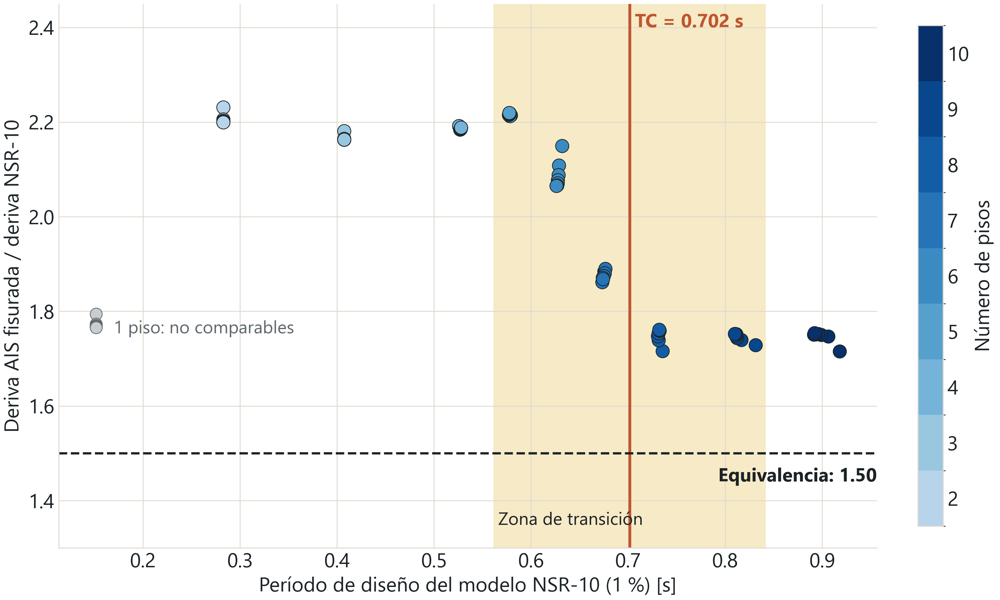

# NSR-10 frente a AIS 100-24: límites de deriva en pórticos planos de Armenia

Estudio de la V Muestra Nacional de Proyectos de Pregrado en Ingeniería, Expresa tu Ingenio 2026.

**Pregunta:** ¿permitir 1.5 % de deriva con secciones fisuradas equivale al 1 % de la NSR-10?

**Alcance:** se comparó la rigidez lateral de 70 pórticos planos regulares de concreto reforzado en Armenia, con el método de fuerza horizontal equivalente de la NSR-10.

**Resultado:** no son equivalentes en los pórticos estudiados. Con la misma sección, la deriva del modelo AIS fisurado es entre 1.72 y 2.23 veces la del modelo NSR-10, mientras que el límite solo sube 1.5 veces. Cumplir 1.5 % con secciones fisuradas exige en mediana 21.0 % más concreto que cumplir 1 %.

## Base normativa

| Qué | Dónde | Valor |
|---|---|---|
| Límite NSR-10 | NSR-10, Tabla A.6.4-1 | 1.0 % |
| Secciones fisuradas en NSR-10 | NSR-10, A.6.4.1.1 | Deriva × 0.7, equivalente a un límite de 1.43 % |
| Límite AIS 100-24 | AIS 100-24, Tabla A.6.4-1 | 1.5 %, grupos de uso I o II con particiones de mampostería |
| Rigideces AIS 100-24 | A.6.4.1.1, A.3.4.3 y C.6.6.3.1.1, Tabla C.6.6.3.1.1(a) | Columnas 0.70 Ig, vigas 0.35 Ig, área 1.0 Ag |

Asociación Colombiana de Ingeniería Sísmica (AIS). (2024). *AIS 100-24: Diseño y construcción sismo resistente de edificaciones*. https://asosismica.org.co/producto/ais-100-24-diseno-y-construccion-sismo-resistente-de-edificaciones/ `[PENDIENTE: confirmar año, editorial y numerales con el documento oficial]`

**Supuestos:**
- C.6.6.3.2.2 permite usar 1.4 × I en cargas de servicio. El estudio usa 0.70 y 0.35 porque A.3.4.3 remite a C.6.6.3.1.1, supuesto confirmado por el director.
- Se usa el mismo espectro NSR-10 en los dos criterios. `[PENDIENTE: verificar si AIS 100-24 cambia Aa/Av de Armenia]`

## Sitio

Los parámetros están en [`sites.csv`](sites.csv).

Aa y Av se revisaron en el texto del Título A de la NSR-10, Decreto 926 de 2010, en los PDF publicados por Camacol y el IDRD, que son idénticos: Tabla A.2.3-2 (página 28 del PDF) y Apéndice A-4 (página 181 del PDF). No se tomaron de sitios web.

| Parámetro | Valor | Fuente |
|---|---:|---|
| Aa, Av | 0.25, 0.25 | NSR-10, Tabla A.2.3-2 y Apéndice A-4, código 63001 |
| Zona de amenaza | Alta | Las mismas |
| Fa, suelo D | 1.3 | NSR-10, Tabla A.2.4-3: interpolado entre 1.4 (Aa = 0.2) y 1.2 (Aa = 0.3) |
| Fv, suelo D | 1.9 | NSR-10, Tabla A.2.4-4: interpolado entre 2.0 (Av = 0.2) y 1.8 (Av = 0.3) |
| I | 1.0 | Grupo de uso I |
| T0, TC, TL | 0.146, 0.702 y 4.56 s | A.2.6 |
| Sa en la meseta | 0.8125 | 2.5·Aa·Fa·I |

## Método

- **Geometría:** 1 a 7 luces de 5 m y 1 a 10 pisos de 3 m, con base empotrada. Son 70 pórticos. No se pasó de 7 luces porque, con 35 m de ancho, las edificaciones reales requieren juntas de dilatación.
- **Secciones:** columna cuadrada de lado c y viga de 0.75c × c, iguales en toda la altura. Se busca la c mínima que cumple cada criterio.
- **Cargas:** w = 35 kN/m en pisos y 25 kN/m en cubierta, más peso propio con γ = 24 kN/m³. f'c = 28 MPa.
- **Período:** Rayleigh con tope Cu·Ta. También se repite sin tope, como versión secundaria.
- **Comparables:** 63 pórticos. Los 7 de 1 piso quedan en la columna mínima de 30 cm y no se comparan.

## Nombres

Las columnas del CSV conservan sus nombres internos.

| En textos y figuras | Modelo | Nombre interno |
|---|---|---|
| NSR-10 (1 %) | Secciones sin reducir, 1.0 Ig | `NSR10_bruta`, `deriva_bruta_pct` |
| AIS fisurada (1.5 %) | 0.35 Ig en vigas, 0.70 Ig en columnas | `AIS100_fisurada`, `deriva_max_pct` |
| NSR-10 fisurada (1.43 %) | Las mismas rigideces | `NSR10_fisurada` |

## Resultados

Todas las cifras y su origen están en [`resultados_clave.md`](resultados_clave.md).

| Caso base | Con tope Cu·Ta | Sin tope |
|---|---:|---:|
| Razón deriva AIS fisurada / deriva NSR-10, mediana | 2.08 | 1.70 |
| Rango de la razón | 1.72 a 2.23 | 1.55 a 2.26 |
| Concreto adicional AIS fisurada, mediana | +21.0 % | +14.7 % |
| Concreto adicional NSR-10 fisurada, mediana | +24.3 % | +21.3 % |

La figura principal es la nube de puntos. Cada punto es un pórtico con la misma sección en los dos modelos.



**El efecto de la fuerza.** Mientras los dos modelos están antes de TC reciben la misma fuerza, y la razón ronda 2.2. Cuando el período del modelo fisurado pasa de TC, ese modelo recibe menos fuerza y la razón cae. Entre 5 y 6 pisos, su período va de 0.645 a 0.760 s y cruza TC = 0.702 s, mientras la razón baja de 2.22 a 2.08. El período del modelo NSR-10 no cruza TC en ese tramo, así que la caída se alinea mejor con el período del modelo AIS fisurado. Desde 8 pisos la razón se estabiliza cerca de 1.75.

**Relación de rigidez viga/columna:** 0.45 en el caso base y 0.88 con vigas de altura 1.25c, con 1.89 de razón y +13.1 % de concreto. La viga no se hace más alta porque, según el criterio del director, no debe ser más fuerte que la columna.

**Alcance sobre columna fuerte–viga débil:** la verificación de resistencia no se hace en este estudio, porque requiere diseñar el refuerzo.

## Figuras

Cada figura tiene su explicación en [`figures/`](figures/): qué muestra, cómo leerla, su tendencia, por qué pasa, qué permite concluir y una frase para decirla en voz alta.

## Verificación

- Siete pórticos, incluidos los extremos, coinciden con OpenSees: diferencia de 4×10⁻¹¹ % en desplazamientos.
- Los pórticos 7×10 y 1×10 coinciden con ETABS: diferencia de 5×10⁻¹¹ % en desplazamientos, giros y fuerzas.
- Demostraciones a mano en [`demostracion_manual/`](demostracion_manual/): pórtico 1×1 con fórmula cerrada y pórtico 3×6 en Excel con fórmulas visibles.

## Reproducir

```bash
python studies/armenia_nsr10_vs_ais/run_study.py
python studies/armenia_nsr10_vs_ais/make_figures.py
python studies/armenia_nsr10_vs_ais/make_key_results.py
```
